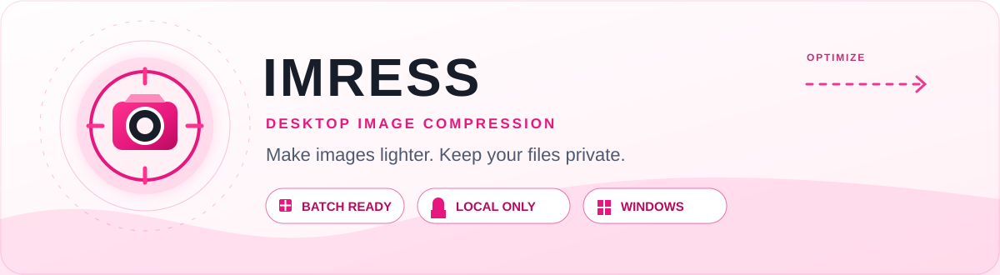
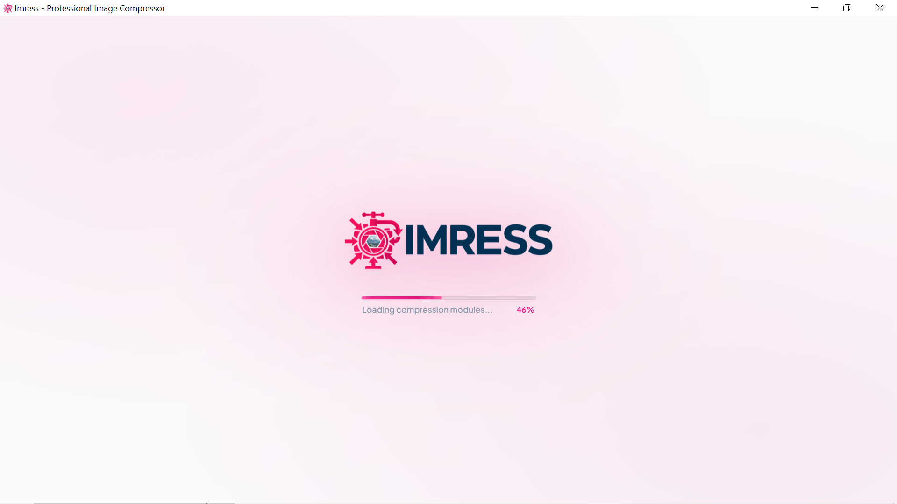
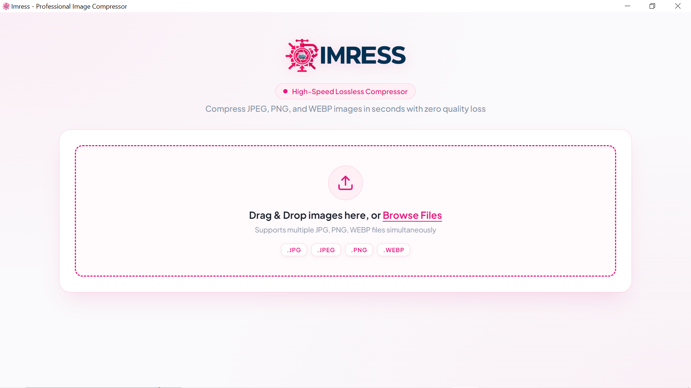
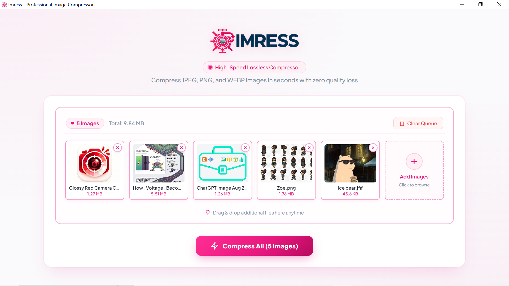
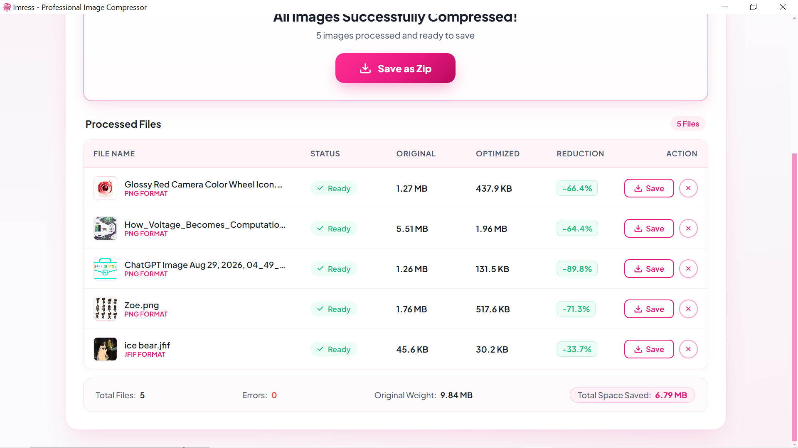

<p align="center">
  
</p>

---

## Why Imress?

Imress is a focused desktop app for making image files smaller without sending them to a cloud service. Drop in a batch, compress it, review the savings, and save files individually or as one ZIP archive.

- **Batch ready** — add multiple images at once with drag and drop.
- **Fast by design** — powered by Sharp with multi-core processing.
- **Clear results** — compare original and optimized sizes per file.
- **Flexible export** — save individual files or download the full batch as a ZIP.
- **Private by default** — processing stays on your computer.

## Product tour

<table>
  <tr>
    <td width="50%" valign="top">
      
      <p align="center"><sub>Fast, polished desktop startup</sub></p>
    </td>
    <td width="50%" valign="top">
      
      <p align="center"><sub>Drag, drop, and select your files</sub></p>
    </td>
  </tr>
  <tr>
    <td width="50%" valign="top">
      
      <p align="center"><sub>Review a batch before compression</sub></p>
    </td>
    <td width="50%" valign="top">
      
      <p align="center"><sub>See savings and export your results</sub></p>
    </td>
  </tr>
</table>

> Every visual on this page is a local repository asset. The header animation and badges are self-contained—no third-party badge service or remotely generated artwork.

## Download for Windows

Install Imress with the 64-bit Windows installer. The button takes you directly to the latest release download.

<p align="center">
  <a href="https://github.com/MaryamFatima5/Imress-Image-Compressor-Tool/releases/latest/download/Imress.Setup.1.0.0.exe">
    
  </a>
  <br>
  <sub>Windows 10/11 · 64-bit installer · <a href="https://github.com/MaryamFatima5/Imress-Image-Compressor-Tool/releases">View all releases</a></sub>
</p>

## How it works

1. **Add images** — drag files into Imress or browse from your computer.
2. **Compress** — optimize the selected batch with a single click.
3. **Save** — download each optimized image or export everything as a ZIP.

## Supported formats

| Format | Input | Output |
| :-- | :--: | :--: |
| JPEG / JPG | ✓ | ✓ |
| PNG | ✓ | ✓ |
| WebP | ✓ | ✓ |

## Privacy

Your images are processed locally by the app. Imress does not upload files to a remote server or require an account to compress them.

## Run from source

### Requirements

- Node.js 18 or later
- npm
- Windows for the packaged desktop installer

```bash
git clone https://github.com/MaryamFatima5/Imress-Image-Compressor-Tool.git
cd Imress-Image-Compressor-Tool
npm install
npm run dev
```

### Build the Windows installer

```bash
npm run build
```

The installer is created in `dist-electron/`.

## Built with

| Layer | Technology |
| :-- | :-- |
| Desktop shell | Electron |
| Compression engine | Sharp |
| Local service | Node.js + Express |
| Archive export | Archiver + JSZip |

## License

Distributed under the [MIT License](LICENSE).

<p align="center">
  <sub>Made for smaller files and a simpler workflow.</sub>
</p>
